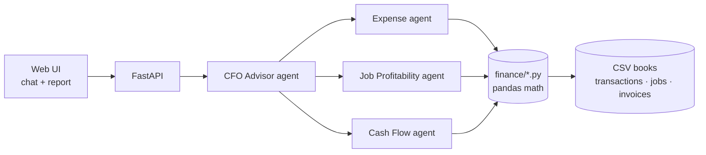

# Toolbelt CFO

An AI CFO for small home-service businesses: contractors, landscapers, HVAC, plumbers and electricians.

Owners sign in, select or create a company, upload their books and ask plain questions. Visitors can explore a read-only demo. A team of AI agents answers with real numbers:

- Why did profit drop this month?
- Which jobs are losing money?
- Can I afford a $15,000 equipment purchase?
- Which customers still owe me money?
- What expenses increased the most?

Built at [Hack Midwest](https://hackmidwest.com/), October 10–11, 2026, in Kansas City.

**[View the project overview →](https://claude.ai/artifact/RVDpWGCVuj2weiRAZy1oqC)** It covers the pitch, agent design, tech stack, 24-hour build plan and demo script.

## Sponsor challenges

| Challenge | How we address it |
| --- | --- |
| **Flex: Best FinTech App** | Cash-flow forecasting, receivables aging, job costing and purchase affordability for businesses that can't afford a real CFO. |
| **AWS: Best Use of Strands Agents SDK** | Four Strands agents. A CFO orchestrator calls three specialist agents as tools, and each specialist has its own finance tools. |

## Example output

```
September Financial Health — Ridgeline Heating & Air

Revenue:   $45,070
Expenses:  $52,900
Profit:    -$7,830

⚠️ Issues
- $21,000 in unpaid invoices (Westport Dental, Brookside Property Mgmt)
- Westport rooftop unit job lost $1,232: the unit's price rose after the bid
- Software up 176%: paying for Housecall Pro and ServiceTitan at once
- Fuel up 35%, insurance up 26% at renewal

💡 Recommendations
- Call Westport and Brookside this week; together they cover the loss
- Cancel one dispatch app (saves $169–$398/mo)
- Add a materials escalation clause to fixed bids
- Finance the $15k equipment purchase instead of paying cash
```

*Mockup of the planned report. Numbers are illustrative.*

## How it works



| Agent | Answers | Tools |
| --- | --- | --- |
| **CFO Advisor** | Routes the question, combines the specialists' answers, writes the report and recommendations | The three specialist agents |
| **Expense** | What went up, what to cut, duplicate subscriptions | `monthly_summary`, `expense_changes`, `recurring_charges` |
| **Job Profitability** | Which jobs and job types make or lose money | `job_profitability`, `losing_jobs`, `margin_by_job_type` |
| **Cash Flow** | Who owes us, cash on hand, can we afford X | `cash_balance`, `receivables`, `affordability` |

All arithmetic will happen in plain Python in `backend/app/finance/`. The agents decide which numbers to pull and explain them, so they never make up figures.

## Tech stack

| Layer | Choice | Why |
| --- | --- | --- |
| Agents | [Strands Agents SDK](https://github.com/strands-agents/sdk-python) (Python) | Required for the AWS challenge. Its agents-as-tools pattern fits a CFO orchestrator with specialists. |
| Models | Claude Sonnet 5.5 (CFO) and Haiku 5.5 (specialists) via the Anthropic API; configurable Bedrock option | See `backend/.env.example` for provider and model settings. |
| Backend | FastAPI | Few files, async, and serves the frontend too. |
| Accounts and data | Supabase Auth + PostgreSQL, encrypted company snapshots, pandas | Owner-only database access; books and bank connections persist across sessions. |
| Frontend | React + JavaScript + Vite, Recharts for charts | Shared components render both the report and the chat's data cards. FastAPI serves the built files from one process. |

## Backend finance development

The sample books, validated loader, and nine finance functions are implemented.
From the repository root:

```bash
bash scripts/setup_backend.sh
source .venv/bin/activate
python -m pytest backend/tests -q
python scripts/demo_finance.py
```

See the [finance function contract and accounting assumptions](docs/finance-contract.md)
for agent/API integration. The finance functions run independently without model
credentials or an API server. The live interface is connected through FastAPI;
see [live dashboard setup and testing](docs/live-dashboard.md).

## Accounts and database

Set up Supabase and the server encryption key using [the account setup guide](docs/accounts.md) before testing private companies or Plaid. Account and company storage are available on `main`. The public demo and offline tests work without a Supabase connection.

## Frontend development

The report, purchase calculator, and upload dialog use live Python results.
Start the backend from the repository root in one terminal:

```bash
.venv/bin/python -m uvicorn backend.app.main:app --reload --host 127.0.0.1 --port 8000
```

In a second terminal:

```bash
cd frontend
npm ci
npm run dev
```

Open the address printed by Vite in your local browser. `npm run build` writes
`frontend/dist`; FastAPI serves those files if built before it starts. Vite
forwards `/api` requests to FastAPI on port 8000 during development.

Chat and AI explanations use Aidan's Strands agents when model access is configured.
Without an API key, the finance dashboard and purchase checks still work, but adding
records in the browser (CSV exports or a bank connection) needs it. The four-file
`POST /api/upload` endpoint still validates all four files before replacing the selected
company’s saved books. See [the live dashboard guide](docs/live-dashboard.md) for Windows commands,
API contracts, upload behavior, and browser integration tests.

## Agents

Four Strands agents live in [`backend/app/agents/`](backend/app/agents/). The CFO
Advisor calls the expense, job profitability, and cash flow specialists, which
use the finance functions. If `backend/.env` does not exist, copy
`backend/.env.example` to it and set `ANTHROPIC_API_KEY` locally. Never commit the key.
The provider and model IDs are configurable; verify your account has access.
Restart the backend after changing its environment configuration.

The API binds each agent stream to the selected authenticated company’s books.
Uploads and resets replace that dataset’s chat history and written-report cache.
Other accounts cannot read these books; another browser signed into the same
account can reopen its saved companies. AI chat history is a temporary server cache.
CLI entry points remain available:

```bash
.venv/bin/python -m backend.app.cli --demo
.venv/bin/python -m backend.app.cli --report
```

See the [agents README](backend/app/agents/README.md) for streaming event shapes.

## Importing a business's own records

Owners can upload any CSV exports they have (bank, card, QuickBooks, Jobber and so on), as many as they like, and connect bank accounts through Plaid. Agents identify each file and categorize transactions; code converts the values and the loader validates the result. Backend only for now: see [docs/imports.md](docs/imports.md) for the endpoints and Plaid setup.

## Planned project structure

```
.
├── backend/
│   ├── app/
│   │   ├── main.py                 # FastAPI: /api/ask, /api/report, /api/upload
│   │   ├── config.py               # model provider settings
│   │   ├── agents/
│   │   │   ├── expense_agent.py
│   │   │   ├── job_profitability_agent.py
│   │   │   ├── cash_flow_agent.py
│   │   │   └── cfo_agent.py        # orchestrator; specialists wrapped as @tool
│   │   ├── finance/
│   │   │   ├── expenses.py         # monthly summary, category changes, subscriptions
│   │   │   ├── jobs.py             # job costing and margins
│   │   │   └── cashflow.py         # cash balance, receivables aging, affordability
│   │   └── data/
│   │       ├── loader.py           # CSV -> pandas, in-memory books
│   │       └── sample/             # sample books
│   ├── tests/
│   └── requirements.txt
├── frontend/                       # React app (Vite)
│   └── src/
│       ├── api/                    # HTTP and streamed events; mock data retained as fixtures
│       ├── components/             # one component per finance function, used by report and chat
│       └── lib/                    # number formatting, theme colors
├── scripts/
│   └── generate_sample_data.py     # builds the sample books
└── docs/
```

## Sample data

The demo will use books for **Ridgeline Heating & Air**, a fictional four-person HVAC and plumbing shop in Kansas City. The data will have a story built in so every demo question has a real answer:

- September profit drops: two big invoices are unpaid and costs rose
- A fixed-bid commercial rooftop job lost money
- The shop pays for two dispatch apps at the same time
- Fuel, insurance and marketing all went up in September

### Planned CSV format

| File | Columns |
| --- | --- |
| `transactions.csv` | `date, description, vendor, category, amount, job_id` (income is positive, spending negative) |
| `jobs.csv` | `job_id, customer, job_type, start_date, end_date, quoted_price, labor_hours, status` |
| `invoices.csv` | `invoice_id, job_id, customer, issued, due, amount, paid_amount, paid_date` |
| `business.json` | name, opening balance, as-of date, labor rate, tax reserve rate |

## Team

Built at Hack Midwest 2026 by:

- Aidan ([@AMcQueen95](https://github.com/AMcQueen95))
