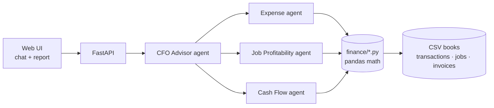

# Toolbelt CFO

An AI CFO for small home-service businesses: contractors, landscapers, HVAC, plumbers and electricians.

Owners upload their books (or use sample data) and ask plain questions. A team of AI agents answers with real numbers:

- Why did profit drop this month?
- Which jobs are losing money?
- Can I afford a $15,000 equipment purchase?
- Which customers still owe me money?
- What expenses increased the most?

Built at [Hack Midwest](https://hackmidwest.com/), October 10–11, 2026, in Kansas City.

**[View the project overview →](https://claude.ai/artifact/RVDpWGCVuj2weiRAZy1oqC)** It covers the pitch, agent design, tech stack, 24-hour build plan and demo script.

## Sponsor challenges

| Challenge | How we address it |
| --- | --- |
| **Flex: Best FinTech App** | Cash-flow forecasting, receivables aging, job costing and purchase affordability for businesses that can't afford a real CFO. |
| **AWS: Best Use of Strands Agents SDK** | Four Strands agents. A CFO orchestrator calls three specialist agents as tools, and each specialist has its own finance tools. |

## Example output

```
September Financial Health — Ridgeline Heating & Air

Revenue:   $45,070
Expenses:  $52,900
Profit:    -$7,830

⚠️ Issues
- $21,000 in unpaid invoices (Westport Dental, Brookside Property Mgmt)
- Westport rooftop unit job lost $1,232: the unit's price rose after the bid
- Software up 176%: paying for Housecall Pro and ServiceTitan at once
- Fuel up 35%, insurance up 26% at renewal

💡 Recommendations
- Call Westport and Brookside this week; together they cover the loss
- Cancel one dispatch app (saves $169–$398/mo)
- Add a materials escalation clause to fixed bids
- Finance the $15k equipment purchase instead of paying cash
```

*Mockup of the planned report. Numbers are illustrative.*

## How it works



| Agent | Answers | Tools |
| --- | --- | --- |
| **CFO Advisor** | Routes the question, combines the specialists' answers, writes the report and recommendations | The three specialist agents |
| **Expense** | What went up, what to cut, duplicate subscriptions | `monthly_summary`, `expense_changes`, `recurring_charges` |
| **Job Profitability** | Which jobs and job types make or lose money | `job_profitability`, `losing_jobs`, `margin_by_job_type` |
| **Cash Flow** | Who owes us, cash on hand, can we afford X | `cash_balance`, `receivables`, `affordability` |

All arithmetic will happen in plain Python in `backend/app/finance/`. The agents decide which numbers to pull and explain them, so they never make up figures.

## Tech stack

| Layer | Choice | Why |
| --- | --- | --- |
| Agents | [Strands Agents SDK](https://github.com/strands-agents/sdk-python) (Python) | Required for the AWS challenge. Its agents-as-tools pattern fits a CFO orchestrator with specialists. |
| Model | Claude Opus 5.5 on Amazon Bedrock | Runs on AWS. Can fall back to the Anthropic API. |
| Backend | FastAPI | Few files, async, and serves the frontend too. |
| Data | pandas + CSV files | No database to set up. Uploading new CSVs replaces the in-memory dataset. |
| Frontend | Static HTML + vanilla JS + Chart.js | No build step, and FastAPI serves it from one process. |

## Backend finance development

The sample books, validated loader, and nine finance functions are implemented.
From the repository root:

```bash
bash scripts/setup_backend.sh
source .venv/bin/activate
python -m pytest backend/tests -q
python scripts/demo_finance.py
```

See the [finance function contract and accounting assumptions](docs/finance-contract.md)
for agent/API integration. This section runs without model credentials or an API
server. Agents and the API/UI remain separate implementation sections.

## Planned project structure

```
.
├── backend/
│   ├── app/
│   │   ├── main.py                 # FastAPI: /api/ask, /api/report, /api/upload
│   │   ├── config.py               # model provider settings
│   │   ├── agents/
│   │   │   ├── expense_agent.py
│   │   │   ├── job_profitability_agent.py
│   │   │   ├── cash_flow_agent.py
│   │   │   └── cfo_agent.py        # orchestrator; specialists wrapped as @tool
│   │   ├── finance/
│   │   │   ├── expenses.py         # monthly summary, category changes, subscriptions
│   │   │   ├── jobs.py             # job costing and margins
│   │   │   └── cashflow.py         # cash balance, receivables aging, affordability
│   │   └── data/
│   │       ├── loader.py           # CSV -> pandas, in-memory books
│   │       └── sample/             # sample books
│   ├── tests/
│   └── requirements.txt
├── frontend/                       # index.html, app.js, styles.css
├── scripts/
│   └── generate_sample_data.py     # builds the sample books
└── docs/
```

## Sample data

The demo will use books for **Ridgeline Heating & Air**, a fictional four-person HVAC and plumbing shop in Kansas City. The data will have a story built in so every demo question has a real answer:

- September profit drops: two big invoices are unpaid and costs rose
- A fixed-bid commercial rooftop job lost money
- The shop pays for two dispatch apps at the same time
- Fuel, insurance and marketing all went up in September

### Planned CSV format

| File | Columns |
| --- | --- |
| `transactions.csv` | `date, description, vendor, category, amount, job_id` (income is positive, spending negative) |
| `jobs.csv` | `job_id, customer, job_type, start_date, end_date, quoted_price, labor_hours, status` |
| `invoices.csv` | `invoice_id, job_id, customer, issued, due, amount, paid_amount, paid_date` |
| `business.json` | name, opening balance, as-of date, labor rate, tax reserve rate |

## Team

Built at Hack Midwest 2026 by:

- Aidan ([@AMcQueen95](https://github.com/AMcQueen95))
